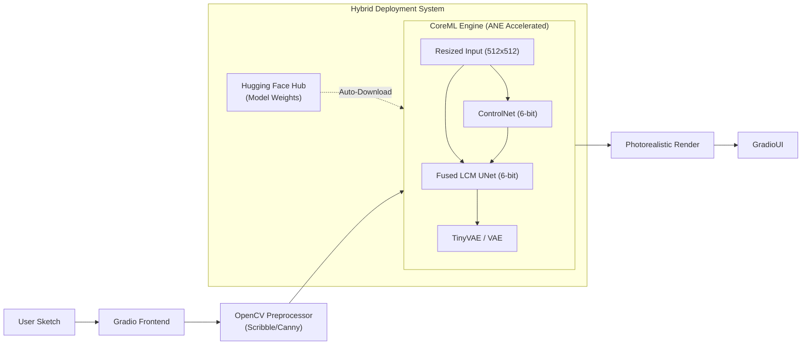
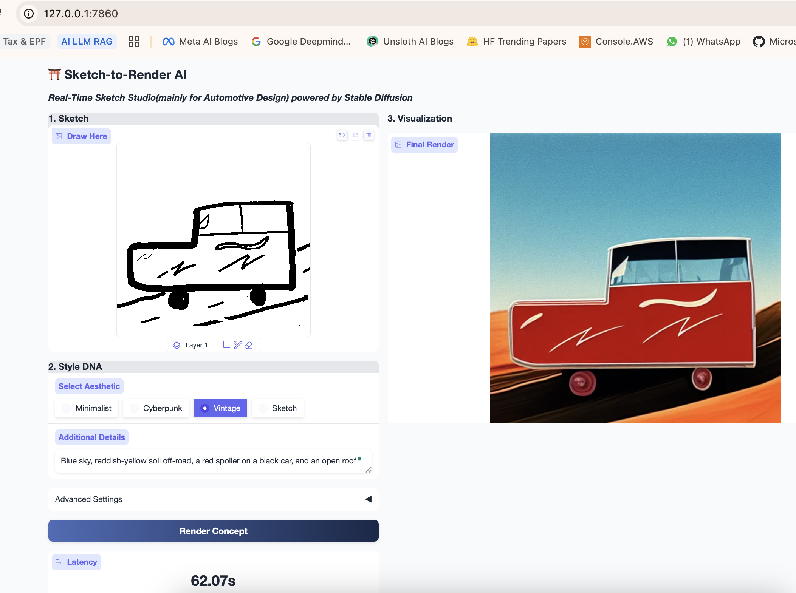
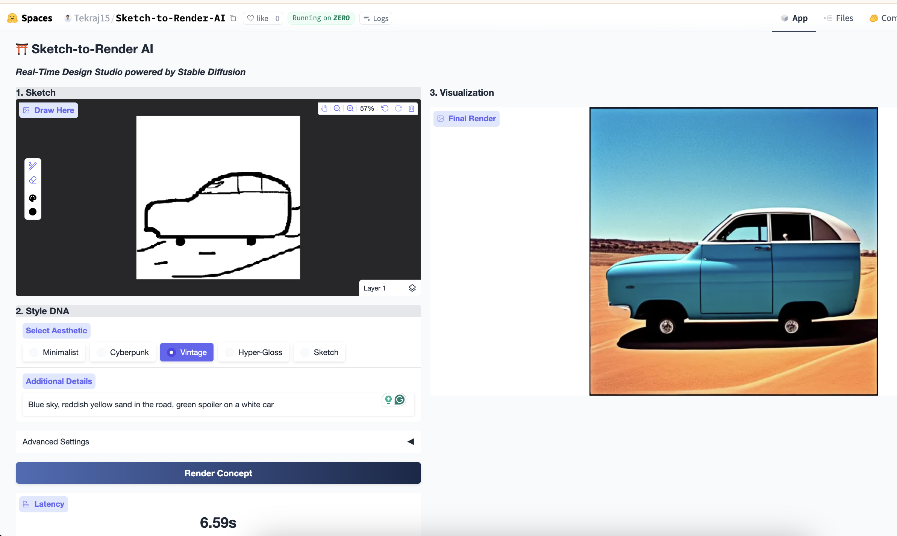
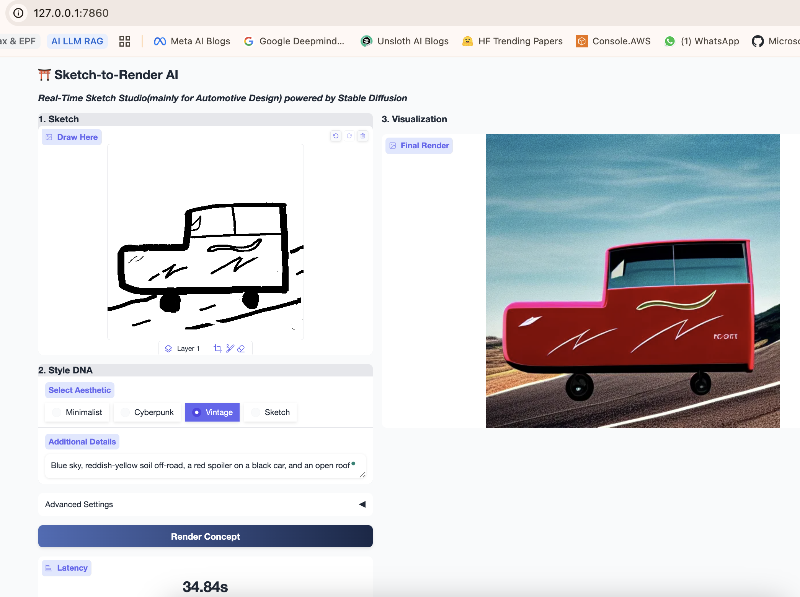
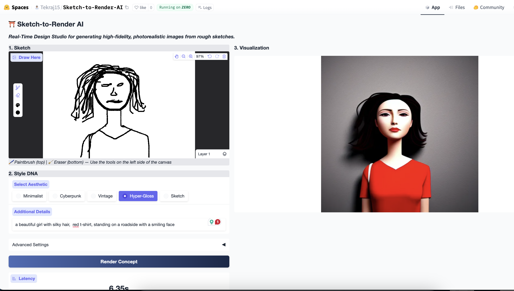

# ⛩️ Sketch-to-Render AI: Fast-Inference Design Studio powered by Stable Diffusion

> Check out the Live App

## TL;DR
> What is it? An interactive Generative AI application that turns rough hand-drawn sketches into photorealistic images/renders in seconds.

> How does it work? Combines Stable Diffusion 1.5 + ControlNet Scribble + LCM-LoRA (for speed).

> Key Innovation: A dual-engine architecture that runs on Apple Silicon (CoreML) for privacy or NVIDIA ZeroGPU (Cloud) for speed (~6s generation).

> Engineering Win: Runs a full Generative AI pipeline on an 8GB MacBook Air (via quantization) and shared cloud GPUs (via step distillation).

## 1. Introduction
Sketch-to-Render AI is a generative AI application designed to transform rough sketches into high-fidelity, photorealistic 3D renders/images in 5-10 seconds. Unlike standard generation tools, this project prioritizes **inference latency** and **multi-platform edge optimization**.

This project aims to move beyond static "prompt-and-wait" workflows to an interactive "paint-and-see" experience. This allows designers to visualize their concepts and generate images instantly as they sketch. This project bridges the gap between high-control Generative AI (ControlNet) and hardware-accelerated edge deployment for both Apple Silicon (CoreML) and NVIDIA (CUDA and PyTorch ZeroGPU(HuggingFace)).

## 2. Objective
Core Utility: Translate low-detail Canny/Scribble inputs into high-fidelity image-like renders across various domains (Automotive, Fashion, Nature) using prompt-guided structural instructions.

Engineering Goal 1 (Control): Implement strict structural guidance using ControlNet Scribble to respect the designer's original geometry while hallucinating realistic textures.

Engineering Goal 2 (Speed): Reduce the computational cost of generation by implementing Latent Consistency Models (LCM). This reduces the inference trajectory from 50 steps (Standard SD1.5) to 4-6 steps, achieving interactive latencies (~5-6s) even on shared cloud resources where standard methods would take 30s+.

Engineering Goal 3 (Efficiency): Optimize memory footprint via **6-bit Quantization** and JIT Compilation to allow the pipeline to run efficiently on constrained local hardware (MacBook Air 8GB) without swapping and dynamic cloud environments.


## 3. Methodology & Architecture



This project follows a three-phase optimization approach:

### Phase I: Baseline Fidelity (The "Quality" Layer)
- Model: Stable Diffusion 1.5 (Chosen for optimal speed/quality trade-off on edge devices).

- Control: ControlNet Scribble. We intercept the U-Net's down-sampling blocks to inject spatial guidance from the user's sketch. We bypass complex edge-detection algorithms and feed the user's raw black-on-white sketch directly into the ControlNet to guide the diffusion process.

- Style: Advanced Prompt Engineering. Currently, style DNA is injected via a modular prompt system (e.g., "Cyberpunk", "Vintage", "Hyper-Gloss") that biases the generic models toward specific design DNAs without prompt engineering overhead. 
Future plan: Training domain-specific LoRAs (e.g., dedicated Porsche/Audi design weights) for stricter style adherence.

### Phase II: Step Distillation (The "Speed" Layer)
- Technique: Replaced the standard scheduler with LCM (Latent Consistency Models).

- Impact: Reduces required denoising steps from 50 to 4 steps.

- Mathematics: Utilizes Probability Flow ODEs to predict the final sample trajectory rapidly (in a single step), bypassing the iterative Markov chain of standard diffusion.

### Phase III: Edge & Cloud Optimization (The "Edge" Layer)

This phase forks the optimization strategy into two distinct paths to ensure maximum performance regardless of the hardware backend.

**A. Apple Silicon Optimization (Local Deployment)**
We ported the pipeline to a strict execution graph for the Apple Neural Engine (ANE).

1. Fuse-then-Compile Strategy: * Instead of applying LoRA adapters at runtime (which is slow), we mathematically fuse the LCM-LoRA weights into the base UNet before compilation, creating a specialized "LCM-Native" model that requires zero extra compute for LoRA steps.

2. CoreML Compilation: * Conversion of UNet, VAE, and ControlNet to .mlpackage format to offload computation to the ANE, bypassing the GPU/CPU bottleneck.

3. Deep Quantization(6-bit):

Critical Win: Standard Stable Diffusion 1.5 requires ~6-8GB VRAM to run. By applying 6-bit quantization, we reduced model size to <1.5GB. 

This allows the entire pipeline to reside in the Neural Engine cache on an 8GB MacBook Air, preventing the Memory Swap/CPU Offloading bottlenecks that typically makes generation take minutes on base-model Macs.


**B. NVIDIA Optimization (Hugging Face / ZeroGPU Deployment)**

For cloud deployment, we utilize a dynamic compilation strategy suited for NVIDIA's A100/H200 architectures via PyTorch 2.0.

1. PyTorch 2.0 JIT Compilation (torch.compile):

- Uses mode="reduce-overhead" to fuse CUDA kernels at runtime, minimizing Python overhead during the rapid 6-step inference loop.

2. ZeroGPU & VAE Stability Hooks:

Challenge: The SD1.5 VAE is unstable in Float16, often causing NaN overflows (black images).

Solution: Applied a custom Type-Safety Hook that intercepts VAE inputs and forcibly casts them to Float32, enabling the heavy UNet to run in fast Float16 while preserving VAE stability.


3. Latency Engineering:

- Replaced the standard pipeline with a custom Static Compute Graph execution loop to minimize Python GIL overhead.

- Adopted TinyVAE (TAESD) in place of Standard VAE for the optimal fidelity-latency trade-off during the decoding stage.


## 4. Tech Stack
**Deep Learning & Computer Vision**: PyTorch 2.x, OpenCV

**Diffusion/Generative Engine**: 
- HuggingFace diffusers (Pipeline orchestration) and diffusers(Apple silicon native)
- LCM-LoRA (Latent Consistency Models for 4-step inference)


**Edge Optimization & Deployment**:

- coremltools & python_coreml_stable_diffusion (Apple Silicon Compilation)

- optimum-quanto (Quantization primitives)

- PEFT (Parameter-Efficient Fine-Tuning loading)

- CUDA (NVIDIA Optimization)

**Frontend/UI**: 
Gradio (Reactive UI with Realtime canvas state management).

**MLOps(Experiment Tracking)**: 
Weights & Biases (W&B) for tracking inference latency, VRAM usage, and FID scores across optimization techniques.


## 5. Results & Performance Benchmarks

All numbers in this section come from the evaluation harness (`benchmarks/run_eval.py`, see §5.4). Each one traces back to a run directory with its config, git SHA, per-render timings and scores. The earlier figures in this section (FID 18.45, CLIP 0.28, IS 7.21, and the "~48 s → ~6.5 s on M2" table) had no reproducible source in the repo, so they have been replaced. FID in particular isn't meaningful on 32 samples.

### 5.1 Example renders

| Local run: CoreML engine on Apple Silicon | Cloud run: CUDA engine on Hugging Face ZeroGPU |
| :---: | :---: |
|  |  |
|  |  |

### 5.2 Latency: edge baseline (CoreML engine, Apple M2, 8 GB RAM)

Measured on SketchBench v0: 13 items × 4 seeds = 52 warm renders at the settings the UI actually sends (4 LCM steps, guidance 1.0, control scale 1.0, 512×512). Run: `20261014-013359_edge_coreml_app_defaults`.

| Stage (per image) | p50 | Share | Runs on |
| :--- | :---: | :---: | :--- |
| **End-to-end** | **27.8 s** (p95 31.3 s) | 100% | |
| ControlNet (4 calls) | 24.2 s | ~87% | PyTorch fp32 on **CPU** |
| UNet (4 calls) | 3.2 s | ~12% | Core ML / ANE |
| VAE decode | 0.3 s | ~1% | Core ML |
| Text encoder | 0.02 s | <1% | Core ML |

- Engine load is 96 s and the first (cold) render takes 42.5 s; neither is included above.
- System swap grew from 3.0 GB to 6.7 GB over the run, so the 8 GB machine is under memory pressure.
- **Takeaway:** ControlNet still runs in PyTorch on the CPU, and that dominates latency. The compiled `ControlNet.mlpackage` isn't wired into the engine yet. In this compile path the UNet chunks are fp16, not 6-bit. Both are the first items on the Round-2 speed roadmap.
- **Cloud (ZeroGPU)** hasn't been measured with the harness yet. Run `configs/eval/cloud_cuda_app_defaults.yaml` on a CUDA machine or the Space.

### 5.3 Quality: edge baseline

Mean with 95% bootstrap CI across items; seeds are averaged within each item first.

| Metric | All (13 items) | Scribbles (3) | Real photos (5) | Shaded drawings (4) |
| :--- | :---: | :---: | :---: | :---: |
| Structure F1 @3 px (HED) ↑ | 0.285 [0.212, 0.366] | 0.535 | 0.209 | 0.231 |
| Structure Chamfer, px @512 ↓ | 16.8 [13.4, 20.3] | 8.2 | 21.5 | 16.3 |
| CLIP-L/14 ×100 vs. user prompt ↑ | 23.3 [21.0, 25.8] | 18.0 | 24.4 | 25.6 |
| PickScore ↑ | 18.53 [17.90, 19.17] | 18.27 | 18.59 | 18.61 |
| HPSv2.1 ↑ | 0.208 [0.190, 0.228] | 0.186 | 0.216 | 0.224 |
| ImageReward ↑ | −0.74 [−1.22, −0.20] | −1.57 | −0.42 | −0.42 |
| DINOv2 similarity to reference photo ↑ | 0.398 [0.265, 0.537] | — | 0.381 | 0.420 |

- Canvas scribbles are followed well (F1 0.54).
- Uploaded photos and shaded drawings are not. On `main` they go through the draw path, which only inverts the image. The model therefore gets a dense, inverted photo instead of an edge map and largely ignores the structure. The single paper-photo item scores F1 0.13: its airplane disappears entirely. This is the baseline for the import-sketch feature.
- Negative ImageReward and modest HPS scores are consistent with the flat, illustrative look of 4-step LCM-LoRA on base SD 1.5.

### 5.4 Reproducing these numbers

```bash
# Use the app environment, plus the scorer extras in requirements-eval.txt
python benchmarks/run_eval.py generate --config configs/eval/edge_coreml_app_defaults.yaml
python benchmarks/run_eval.py score --run eval/runs/<run_dir>          # writes report.md + grid.png
python benchmarks/ab_rater.py --run-a eval/runs/<A> --run-b eval/runs/<B> --rater <name>   # blind human A/B
```

SketchBench, its data policy and how to add items are described in [`eval/sketchbench/README.md`](eval/sketchbench/README.md).
